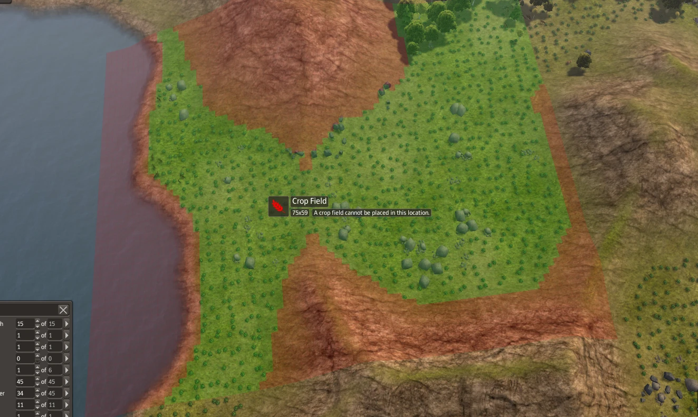
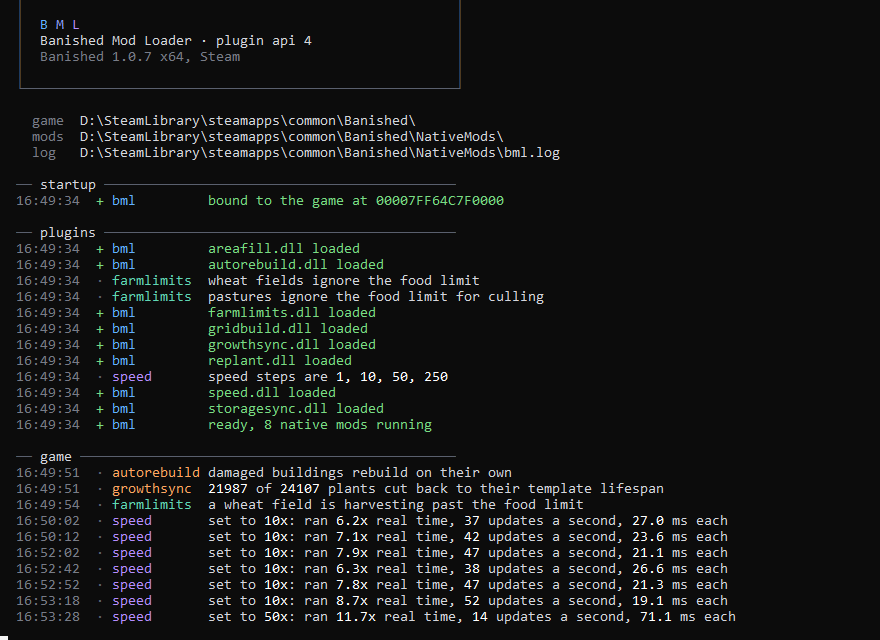

  

  

  
  
  

The Banished mod kit can only change data. BML loads real code mods, so it can add new
tools and change how the game behaves.

## Install

1. Download the zip from [the latest release](https://github.com/skippyznjiffy/banished-mod-loader/releases/latest).
2. Unzip it into your Banished folder (`steamapps\common\Banished`).
3. Start the game. Delete the plugins you don't want from `NativeMods`.

To remove it, delete `dinput8.dll`. No game files are changed.

## Plugins

| Plugin | What it does |
|---|---|
| Grid Build | Shift-drag any building to fill an area with rows of them and roads |
| Area Fill | Shift-drag a field or pasture over rough ground, it fits in what it can |
| Replant | Shift-drag the Forester Lodge to plant a forest |
| Speed | Speeds of 1, 10, 50 and 250 instead of 1, 2, 5 and 10 |
| Auto Rebuild | Burnt buildings rebuild themselves |
| Farm Limits | Wheat fields and pastures keep working past the food limit |
| Storage Sync | Storage mods also grow the barns you already built |
| Growth Sync | Plant mods also apply to the trees and herbs already on the map |

More on each one in [docs/plugins.md](docs/plugins.md).

  
   Without Area Fill, a few bad tiles and the whole field is refused

  
   The BML console shows what loaded and how fast the game runs

## Good to know

- Only works on the 64-bit Steam version, 1.0.7. On anything else it turns itself off.
- Some antivirus programs flag it, since loading through `dinput8.dll` is also what cheats
  do. The source is all here if you'd rather build it yourself with `build.bat`.
- There's a BML button in the main menu that lists your active mods.

Want to write your own plugin? See [docs/api.md](docs/api.md).

MIT licensed. Banished belongs to Shining Rock Software, none of its code is in here.
